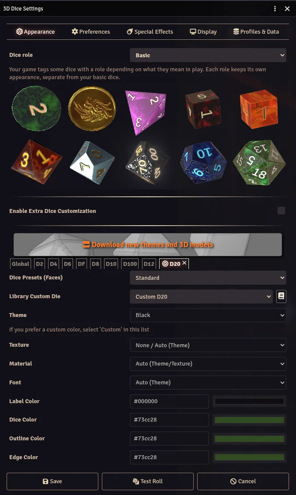

The Appearance tab controls the visual style of your dice. Every setting here is per-player and per-world.

## Global Settings

These apply to all your dice by default:

- **Dice Presets (Faces)** - Select the dice face style. "Standard" uses text labels on every face. Some game systems force a specific preset for all players to display their own custom dice.
- **Theme** - Select a color theme. Themes change all color settings at once and can include multiple random colors selected each roll. A theme may also include a default texture.
- **Texture** - Select a texture for the dice. Choose "None / Auto (Theme)" to use the theme's built-in texture, if any.
- **Material** - Select a material (plastic, metal, glass, wood, chrome, stone, velvet, resin, frosted, pristine, iridescent). "Auto (Theme)" uses the theme's default material.
- **Font** - Select a font for the dice labels. "Auto (Theme)" uses the theme's font. Dice So Nice! uses Foundry VTT's font system, so any font added via Foundry's Font Manager will be available here.

## Color Pickers

Four color pickers let you fine-tune the dice appearance:

- **Label Color** - The color of the text/numbers on each face.
- **Dice Color** - The base color of the dice body.
- **Outline Color** - The color of the outline around each label.
- **Edge Color** - The color of the dice edges (bevels).

## Per-Die Customization

You can customize individual die types instead of using global settings for all dice:

1. **Click on any die** in the 3D preview to select it.
2. Adjust settings for that specific die type (e.g., give your d20 a different color than your d6).
3. Per-die settings override the global settings for that die type only.

When a die type is selected, you can also open the [Dice Library](/foundryvtt-dice-so-nice/guide/dice-library/) from the Appearance tab to browse and apply custom dice.

## Dice Roles

Some dice can play a specific role in your game: damage types, some system special dice, etc. When your game system or the GM makes a role customizable, a **Dice role** dropdown appears above the 3D preview. It lists *Basic* (your regular dice) plus every role you may customize, grouped by origin.

Picking a role swaps the whole Appearance tab to that role: same preview, same die type tabs, same controls, different data. Your basic dice are untouched.

- Every field of a role starts on **Inherit**. An inheriting field falls back to the world appearance set by the GM for this role, then to the defaults of the package that registered the role, then to your basic *Global* settings.
- The reset icon next to the **Dice role** dropdown clears your customization of the role you are editing, back to full Inherit. Your basic dice and the other roles are untouched.

The preview's test roll tags its dice with the selected role, so what you see is what those dice will look like in play.

## Extra Dice Customization

Enable **Extra Dice Customization** to access appearance settings for special dice types like d3, d5, d7, d14, d16, d24, and d30. These dice are less common but used by some game systems (e.g., DCC).

## Per-Actor Appearance

You can also configure a unique dice appearance for individual characters. See [Per-Actor Appearance](/foundryvtt-dice-so-nice/guide/actor-appearance/) for details.

## Disabling 3D Dice

If a player does not want 3D dice animations, they can set **Dice visibility** to *Hide all* in the [Preferences](/foundryvtt-dice-so-nice/guide/preferences/#visibility) tab or in the Dice So Nice! sidebar tab. This only affects that player. Other players continue to see their own 3D dice normally.
