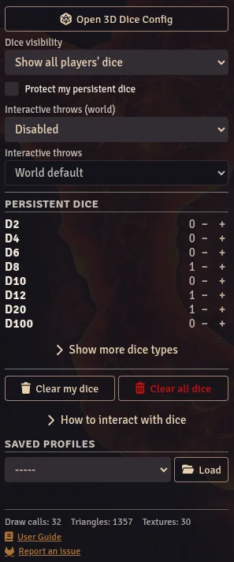

Persistent Dice lets you place 3D dice directly on the virtual tabletop. Unlike regular dice that appear during a roll and disappear, persistent dice stay visible on screen and can be physically interacted with, recreating the experience of rolling real dice around a physical tabletop.

## How It Works

Persistent dice use Foundry VTT's built-in random number generator (RNG) to determine results, not physics. When you throw a persistent die, Foundry generates the result and the die animation is adjusted to land on that number. This ensures fair, deterministic results while keeping the physics-based animation looking natural.

## Adding Dice

Persistent dice must first be enabled by the GM in the module settings (**Enable persistent dice on tabletop**).

Use the **Persistent Dice** section of the [Dice So Nice! sidebar tab](/foundryvtt-dice-so-nice/guide/getting-started/#sidebar-tab) to add dice to the tabletop:

1. Open the Dice So Nice! tab in the right sidebar.
2. Click **+** next to the die type you want to add (d4, d6, d8, d10, d12, d20, etc.). **Show more dice types** lists the less common ones.
3. The die appears on the tabletop using your current appearance settings, at your **Persistent dice spawn location** (see [Preferences](/foundryvtt-dice-so-nice/guide/preferences/#persistent-dice)).

## Interacting with Dice

### Pick Up and Move

- **Click and hold** a die to pick it up.
- Move your mouse to reposition it.
- **Release gently** (without momentum) to place it back down without rolling.

### Throw

- **Click and hold** a die, then **shake** it (move the mouse back and forth quickly) or **make a circle** with the mouse while holding.
- The gesture detection counts direction reversals (shaking) and rotational sweep (circular motion). Simply dragging and releasing quickly will not trigger a throw.
- The result appears in the chat log, just like any other Foundry roll.

### Multi-Select

- Hold **Ctrl** and click individual dice to select multiple.
- All selected dice can be thrown together.

## Removing Dice

- Click **−** next to a die type to remove your most recently placed die of that type.
- Select dice and press **Delete** or **Backspace** to remove them.
- **Clear my dice** removes all your persistent dice. The GM also gets **Clear all dice**, which removes every player's dice.

## Visibility

The **Dice visibility** setting of the sidebar tab also applies to persistent dice: *Show only mine* hides the other players' dice without removing them.

## Multiplayer

- All players in the world can see persistent dice placed by any player.
- Dice use the placing player's appearance settings.
- When a player picks up a die, it is **locked** for other players - only one person can interact with a die at a time.
- Check **Protect my persistent dice** in the sidebar tab to prevent other players from grabbing or throwing your dice. The GM can always grab them.
- Positions are synchronized across different screen resolutions using relative coordinates.

