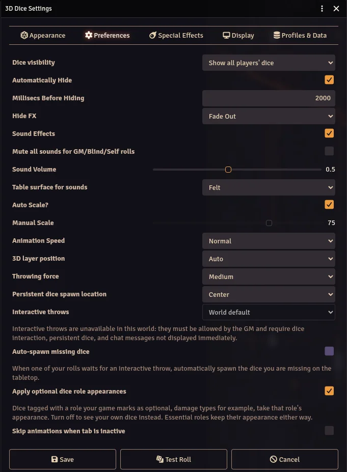

The Preferences tab controls how dice behave during and after a roll.

## Visibility

- **Dice visibility** - Which 3D dice you see. Also available from the Dice So Nice! sidebar tab.
  - **Show all players' dice** - You see every 3D roll and every persistent die.
  - **Show only mine** - You only see your own rolls and your own persistent dice.
  - **Hide all** - Disables 3D dice on your client. Switching to or from this option asks you to reload Foundry.
- **Automatically Hide** - When enabled, dice disappear automatically after the result is displayed.
- **Millisecs Before Hiding** - Time in milliseconds before dice auto-hide (default: 2000ms). Only visible when Automatically Hide is enabled.
- **Hide FX** - The visual effect used when dice disappear (fade out, etc.).

## Sound

- **Sound Effects** - Enable collision sounds with realistic rolling effects.
- **Mute all sounds for GM/Blind/Self rolls** - Prevents players from hearing your secret dice through voice chat.
- **Sound Volume** - Dice sound effect volume. Applied on top of Foundry's "Interface" volume slider.
- **Table surface for sounds** - The type of surface sound: felt, wood table, wood tray, or metal.

## Scale and Speed

- **Auto Scale** - Automatically scales dice size based on your display dimensions.
- **Manual Scale** - Set a custom dice size (only when Auto Scale is off).
- **Animation Speed** - How fast the dice roll and settle (Normal, 2x, 3x).

## Display

- **3D Layer Position** - Controls where dice appear relative to the Foundry UI:
  - **Auto** - Respects Foundry's focus system. The 3D overlay layer position adjusts based on what currently has focus (the canvas, a character sheet, etc.), following Foundry's native window stacking behavior.
  - **Over sheets** - Dice always appear on top of everything.
  - **Under sheets** - Dice appear below the UI, visible only on the canvas.

## Physics

- **Throwing Force** - The intensity of the roll: weak, medium, or strong. Affects how far dice travel and how much they bounce.

## Persistent Dice

- **Persistent dice spawn location** - Where your new [persistent dice](/foundryvtt-dice-so-nice/guide/persistent-dice/) appear on the tabletop: center, top-left, top-right, bottom-left or bottom-right.

## Interactive Throws

These settings are greyed out when the GM has not made [interactive throws](/foundryvtt-dice-so-nice/guide/interactive-throws/) available in the world.

- **Interactive throws** - When your rolls wait for you to throw the dice on the tabletop:
  - **World default** - Follows the GM's world setting.
  - **Never** - Your rolls always play the normal 3D animation.
  - **Only when requested** - Your rolls stay normal unless the game system asks for a throw.
  - **Whenever possible** - Every eligible roll waits for your throw.
- **Auto-spawn missing dice** - When one of your rolls waits for a throw, the dice you are missing on the tabletop are spawned automatically.

## Dice Roles

- **Apply optional dice role appearances** - When enabled, dice tagged with a role your game marks as optional (damage types, by default) take that role's appearance. Disable to see your own dice instead. Roles marked as essential by your game system or the GM (a system's special dice, for example) keep their appearance either way.

### Dice Roles table (GM Only)

A **role** is what a die means in your game: a damage type, a special die of your game system... Every role can have its own world-wide appearance, set by the GM. The **Dice Roles** button is available in the Dice So Nice! section of Module Settings (see [Getting Started](/foundryvtt-dice-so-nice/guide/getting-started/#action-buttons)).

Each row of the table is a role and shows:

- **Role** and **Group** - the label and the group it belongs to ("Damage Types", the name of your game system...).
- **Origin** - *Built-in* for the damage types that ship with the module, *Registered* (with the package id) for roles added by a game system or a dice pack, *Custom* for roles you created.
- **Detectors** - how a die gets this role: modifier tokens declared by the registering package (i.e. `h`, `f`), or type ids matched against the damage type or flavor of the roll.
- **Players** - two indicators: whether players may customize this role in their own dice settings, and whether they may turn it off with their "Apply optional dice role appearances" preference.
- **Dice Preset** and **Theme** - quick pick of the world-wide look of the role. *Inherit* leaves the field to the registering package defaults, then to each player's basic dice.
- **Appearance...** - opens the full dice settings editor targeted at the world appearance of this role.
- **Reset to default** clears the world appearance of the role, **Delete** removes a custom role (registered and built-in roles are greyed out instead and can be restored).

**Add role** and the gear icon of a row open the role settings: the two player permissions, plus the label, id and type ids of a custom role (the id is derived from the label when left empty). Save the table before opening *Appearance...* on a new role.

:::note[How a die gets its final look]
For a die in a role, fields are resolved in this order: the player's own appearance for that role (only for roles players may customize), the world appearance set here, the defaults of the package that registered the role, then the player's basic global settings. A roll that sets its own appearance through the API still wins over all of these.
:::

## Inactive Tab

- **Skip animations when tab is inactive** - By default, when you come back to Foundry from another browser tab, the rolls made in the last 10 seconds are played. Enable this to skip them instead.
